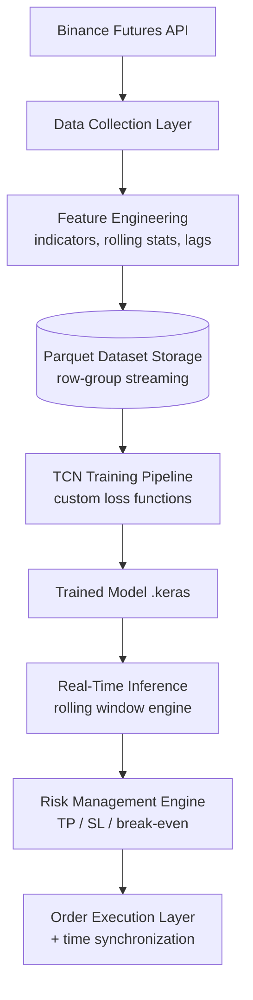
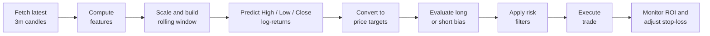

<div align="center">

# 📈 Crypto TCN Trading System

### Architecture Showcase

**A deep-learning crypto trading system built around a Temporal Convolutional Network (TCN), with large-scale feature engineering, streaming datasets, real-time inference and risk-managed execution.**


[Architecture](ARCHITECTURE.md) · [Trade flow](SYSTEM_FLOW.md) · [Example output](example_prediction_output.json) · [Contact](#-contact)

</div>

---

> [!IMPORTANT]
> **This repository is an architecture showcase.** It presents the high-level engineering design of the system. The full production trading engine, feature-engineering engine and model training pipeline are **proprietary and not included**.

## 🎯 What this system does

The system collects market data, turns it into model-ready features, trains a TCN to forecast price movement, and uses those forecasts to open, manage and close trades automatically, all behind a structured risk-management layer.

## ✨ Key engineering highlights

| | Highlight |
|---|---|
| 🧮 | **Large-scale feature engineering** with technical and statistical indicators (RSI, MACD, Bollinger Bands, ATR, rolling statistics, lags and candle structure) |
| 💾 | **Lazy Parquet row-group streaming**, so datasets larger than memory can be used for training |
| 🧠 | **Multi-target TCN forecasting** of High, Low and Close |
| 🎯 | **Trading-aware custom loss functions** |
| ⚡ | **Real-time inference** with a rolling-window engine that generates signals |
| 🛡️ | **Structured risk management**: position sizing, adaptive leverage, dynamic take-profit and stop-loss, break-even fallback |
| 🔄 | **Server time synchronization** to prevent signing and API drift errors |

## 🏛️ System overview



For a component-by-component breakdown, see **[ARCHITECTURE.md](ARCHITECTURE.md)**.

## 🔄 Example trade flow

Every cycle follows the same loop, described in **[SYSTEM_FLOW.md](SYSTEM_FLOW.md)**:



## 🧩 Core components

| Layer | Responsibility |
|---|---|
| **Data collection** | Historical and live OHLCV from Binance Futures, multiple timeframes, rate limiting and batching |
| **Feature engineering** | Technical indicators, rolling statistics and volatility, lag and candle-structure features, normalized model-ready sets |
| **Model training** | TCN architecture, multi-target forecasting, custom loss functions, Parquet streaming |
| **Inference engine** | Loads the trained model, builds rolling feature windows in real time, produces forward price projections and directional signals |
| **Risk management** | Position sizing, adaptive leverage, dynamic take-profit and stop-loss, break-even fallback, ROI-based monitoring |
| **Order execution** | Market and limit orders, position monitoring, conditional orders, server timestamp sync, continuous monitoring of active trades |

## 🏗️ Infrastructure considerations

- Binance server-time synchronization for accurate request signing
- Modular separation of training and execution environments
- Parquet row-group streaming for large-dataset efficiency
- Environment-based configuration management
- Fault tolerance and exception handling during live trading

## 🔬 Public code sample: exchange time synchronization

Signed requests to an exchange fail when the local clock drifts from the server's. [`binance_time.py`](binance_time.py) is the one real module shared here. It solves that problem:

- Reads Binance Futures server time and computes the offset against the local clock
- Compensates for network latency by using the midpoint of the request's round trip
- Re-syncs automatically in a background thread (every 5 minutes by default)
- Keeps the last good offset if a sync request fails, so trading never blocks on it
- Is thread-safe and exposes `now_ns()` and `now_ms()` for server-aligned timestamps

```python
from binance_time import BinanceTimeSync

clock = BinanceTimeSync(sync_interval=300)
timestamp = clock.now_ms()   # server-aligned time in milliseconds
```

## 📤 Example prediction output

For each cycle the model produces forward price projections for the next candle, which the risk layer then filters:

```json
{
  "symbol": "BTCUSDT",
  "timeframe": "3m",
  "current_open_price": 65200.50,
  "predicted_high": 65420.12,
  "predicted_low": 64980.33,
  "predicted_close": 65280.40
}
```

*Illustrative values, not real market data or a trading signal.*

## 📂 What's in this repository

| File | Purpose |
|---|---|
| [`ARCHITECTURE.md`](ARCHITECTURE.md) | Full architecture and component descriptions |
| [`SYSTEM_FLOW.md`](SYSTEM_FLOW.md) | Step-by-step example trade flow |
| [`binance_time.py`](binance_time.py) | Background Binance server-time synchronization |
| [`example_prediction_output.json`](example_prediction_output.json) | Example of the model's prediction output |
| [`Images/`](Images) | Diagrams and visuals |
| [`LICENSE`](LICENSE) | MIT license |

<!-- TODO: add a screenshot or chart here, e.g.  -->

## ⚠️ Disclaimer

This project is shared for educational and demonstration purposes. Trading cryptocurrency, especially with leverage, carries a high risk of loss. Nothing here is financial advice, and past or simulated results do not guarantee future performance.

## 📩 Contact

For collaboration, licensing or commercial discussions: **emdi.osuji@gmail.com**

<div align="center">

**Michael-David Osuji**, AI Engineer
[LinkedIn](https://www.linkedin.com/in/michael-david-osuji) · [GitHub](https://github.com/Emdysuji)

</div>
